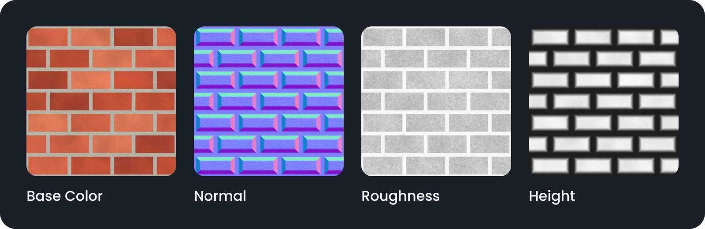

<p align="center">
  <picture>
    <source media="(prefers-color-scheme: dark)" srcset="branding/mat-baker-logo-dark.png">
    
  </picture>
</p>

<p align="center">
  

  <a href="LICENSE">
    
  </a>
  <br><br>
  <a href="https://extensions.blender.org/add-ons/mat-baker/">
    
  </a>
  <br><br>
  <a href="https://extensions.blender.org/add-ons/mat-baker/">
  
</a>
</p>

**Bake procedural materials into PBR texture packs.**
One click turns a node-based material into Base Color, Normal, Roughness, Metallic, Height, AO, Emission, Opacity and Curvature maps, with presets for Unreal, Unity, glTF and Godot.

Blender add-on / extension by **SANJAYA3D** · GPL-3.0-or-later · requires Blender 4.2 or newer

<p align="center">
  <br>
  <sub>Illustration (generated for this README, not a screenshot): a procedural brick material and four of the maps Mat-Baker writes.</sub>
</p>

---

## Features

- **Simple mode** – pick an engine preset, pick a resolution, press **Export Texture Pack**.
- **Advanced mode** – every setting: which maps, packing, AO / curvature, file format, bit depth, bake target, samples.
- **Works with any procedural material** – colour and data channels are read from whatever node network feeds the Principled BSDF.
- **Pre-flight checklist** – the panel shows which maps your material can produce, with a short hint for each one it can't, before you export.
- **Engine presets** – Generic, Unreal Engine, Unity URP / Built-in, Unity HDRP, glTF / Godot / Three.js, Everything.
- **Packed textures** – ORM, Unity HDRP Mask map, Unity Metallic-Smoothness (RGBA).
- **Derived maps** – AO and Curvature computed from the height map; tileable textures stay tileable.
- **Normal map convention** – OpenGL (+Y) or DirectX (−Y).
- **PNG, TIFF or OpenEXR**, 8 / 16 / 32-bit, standard or Unreal-style file names, optional JSON manifest.
- **Stays responsive between maps** – progress bar in the panel, **Esc** cancels (after the current map finishes).
- **Models with many materials** – bake all materials of an object into **one** texture set through its UV map.
- **UDIM** – one file per UV tile (`Name_BaseColor.1001.png`, …) for models that use UDIM tiles.
- **Batch export** – the active object, all selected objects, or everything in the file.
- **Preview Material** – builds a ready-to-assign Blender material from the exported files so you can check the result.
- **Your scene stays clean** – works on a copy of the material; all temporary data is removed and all settings are restored, even when you cancel.

## Install

**From the Blender Extensions platform** (once the listing is approved):
`Edit ▸ Preferences ▸ Get Extensions` → search for **Mat-Baker** → **Install**.

**From a GitHub release:**
1. Download `mat_baker-1.2.0.zip` from the [Releases](https://github.com/SANJAYA3D/Mat-Baker/releases) page. **Do not unzip it.**
2. In Blender: `Edit ▸ Preferences ▸ Get Extensions`, open the **▾** menu (top right) → **Install from Disk…** and pick the zip.

The panel appears in the 3D Viewport sidebar (press `N`) on the **Mat-Baker** tab, and in `Properties ▸ Material`.

## Quick start

1. Select an object that has your procedural material.
2. Open the **Mat-Baker** tab (`N` panel).
3. Choose a **Preset**, a **Resolution** and an **Output folder** (`//` means "next to the .blend file"; save your .blend first, or use an absolute path).
4. Check the list: ✔ = will be exported, ✖ = not available for this material.
5. Click **Export Texture Pack**. Use **Open Folder** to see the files and **Preview Material** to build a material from them.

Output looks like this:

```
pbr_export/
└── Rock/
    ├── Rock_BaseColor.png
    ├── Rock_Normal.png
    ├── Rock_ORM.png          (packed: R = AO, G = Roughness, B = Metallic)
    └── Rock_pbr.json         (resolution, normal convention, file list, height info)
```

## Models with many materials (one texture set)

A model with several materials can be baked into **one** set of maps (one Base Color, one Normal, …) instead of one set per material:

1. Select the model and choose **Bake target ▸ Whole Object (all materials in one set)**.
2. Pick the **UV Map** to bake into. It must be **one layout shared by all materials, with nothing overlapping**.
   If your UVs tile or overlap, unwrap the model into a new UV map first (for example *Smart UV Project* or *Lightmap Pack*), then select that map here.
3. Check the panel: it lists the materials, shows how much of the UV square is covered, and warns when UVs overlap or leave the 0–1 square.
4. Click **Export Texture Pack**. You get one set named after the object (`Prop_BaseColor.png`, `Prop_Normal.png`, …).

How it works: every face is baked through **its own material** into the same image. A map that only some materials provide is filled with neutral defaults for the others (black emission, fully opaque, flat height, default grey colour), and empty material slots are baked as default grey.
Use the result with the same UV map: assign the texture set (or **Preview Material**) to the model with that UV map active.

Good to know: the overlap check is an estimate – it flags UV coverage above 100 % and UVs outside the square, but it cannot see overlaps in a layout that covers less than the whole square. **Export** can run for one object, all selected objects (one set each) or every mesh object in the file.

## UDIM tiles

If your model uses **UDIM** (UV islands spread over tiles 1001, 1002, 1011 … outside the 0–1 square), Mat-Baker can write one file per tile:

1. Choose **Bake target ▸ Whole Object** and tick **UDIM Tiles**.
2. Pick the UV map that holds the UDIM layout. The panel shows which tiles it uses, for example `UDIM: 3 tile(s): 1001, 1002, 1011`, and warns about problems.
3. Click **Export Texture Pack**. Each tile is baked at the chosen resolution and saved as `Prop_BaseColor.1001.png`, `Prop_BaseColor.1002.png`, … (the same for Normal, Roughness, packed textures and so on).

Tile numbers follow the usual rule: **1001 + U + 10 × V**. The manifest lists the tiles and uses the `<UDIM>` token (`Prop_BaseColor.<UDIM>.png`), which Blender, Substance, Unreal and most other tools understand.

Things to know:
- **AO is baked by Cycles** (needs real geometry, which a model has). **Curvature and Normalize Height are not available** with UDIM: they are computed from one image's height map and would differ from tile to tile.
- Each tile is a full image, so export time grows with the number of tiles. Up to 100 tiles are supported.
- Faces must lie inside one tile. The panel warns about faces that cross a tile border, UVs outside the UDIM range (U 0–10, V above 0) and overlaps inside a tile.
- While baking, Mat-Baker temporarily adds **one UV map** to the object (the model must have a free slot: Blender allows 8). It is removed afterwards and your own UV maps are never changed.
- *Keep Images in Blender* is ignored for UDIM exports (the tiles are saved to disk and the images are freed).
- **Preview Material** builds UDIM images from the first tile's file and registers the other tiles. If your Blender version cannot do that automatically, add the missing tiles in the Image Editor (*Tiles* panel).

## Presets

| Preset | Files written | Normal Y | File names |
|---|---|---|---|
| Generic / Blender | Base Color, Normal, Roughness, Metallic, Height, AO, Emission, Opacity | OpenGL | `Name_BaseColor` … |
| Unreal Engine | Base Color, Normal, Height, Emission, Opacity + **ORM** | DirectX | `Name_BC`, `_N`, `_H`, `_E`, `_O`, `_ORM` |
| Unity URP / Built-in | Albedo, Normal, Height, AO, Emission, Opacity + **Metallic-Smoothness** | OpenGL | `Name_Albedo` … |
| Unity HDRP | Albedo, Normal, Height, Emission, Opacity + **Mask map** | OpenGL | `Name_Albedo` … |
| glTF / Godot / Three.js | Base Color, Normal, Emission, Opacity + **ORM** | OpenGL | `Name_BaseColor` … |
| Everything | all nine maps + ORM | OpenGL | `Name_BaseColor` … |

Changing any map / packing / normal setting switches the preset to **Custom**.

## Packed textures

| Packed texture | R | G | B | A |
|---|---|---|---|---|
| ORM | AO | Roughness | Metallic | – |
| Unity HDRP Mask | Metallic | AO | 0 (detail mask) | Smoothness (1 − roughness) |
| Unity Metallic-Smoothness | Metallic | Metallic | Metallic | Smoothness (1 − roughness) |

## How each map is made

| Map | Source |
|---|---|
| Base Color, Roughness, Metallic, Emission, Opacity | The node connected to that Principled BSDF input. Unconnected inputs are exported as constant maps, except an opaque Alpha or a non-emissive Emission, which are skipped. |
| Normal | Cycles tangent-space bake of the final shading normal (Normal Map / Bump nodes and Displacement nodes are included). |
| Height | The **Height** input of the connected Displacement node (or Bump node). |
| AO (default) | Computed from the height map – a horizon-based approximation, ideal for flat tileable textures. Optionally a real Cycles AO bake on an object with geometry. |
| Curvature | Computed from the height map (0.5 = flat, brighter = convex edges, darker = cavities). |

Colour maps are saved as sRGB, data maps (normal, roughness, …) as untouched Non-Color values, and EXR files are linear.

## Good to know

- **Bake target.** *Flat Plane* (default) bakes each material onto a temporary plane (2 m by default) with 0–1 UVs – one set per material, which is what you want for tileable texture packs. *Whole Object* bakes all materials of an object into one set using the object's UV map (see above).
- **Height-based maps need a height source.** Normal, Height, AO and Curvature come from a Displacement or Bump node with a connected *Height* input. Without one, those maps are skipped and the panel tells you why.
- **Principled BSDF.** It has to be at the top level of the material's node tree, not inside a node group. If there are several, the first one connected to the output is used.
- **Resolution and memory.** 4K works on most machines; 8K needs a lot of RAM, especially with 16/32-bit output.
- **Preview Material** is available until you restart Blender (the list of exported files is kept in memory, not in your .blend).
- **Tileability** comes from your material. Mat-Baker keeps tileable input tileable, it does not make a non-tileable material tileable.

## What Mat-Baker changes in your file (temporarily)

While exporting, Mat-Baker:

- makes a **copy of your material** (in *Whole Object* mode: a copy of each material of the object) and bakes the copies – the originals are never modified,
- adds a temporary **plane object, mesh, images and a scene** (names start with `_MATBAKER_`) and removes them again,
- switches the render engine to **Cycles** and adjusts the bake settings, then **restores them**,
- in *Whole Object* mode, temporarily assigns those copies to the object's material slots and makes the chosen UV map active, then **puts both back**; with *UDIM* it also adds one temporary UV map and removes it again,
- restores your selection and active object afterwards.

It writes files **only** into the output folder you choose. **Preview Material** (on request) adds a material named `<Name>_PBR` that uses the exported files. It never touches the network, collects nothing and sends nothing.
The only permission it requests is *files* ("Save baked texture files to a folder you choose").

## Troubleshooting

| Problem | What to do |
|---|---|
| "Save the .blend file first…" | The output folder starts with `//`. Save the .blend, or enter an absolute folder. |
| "The Cycles add-on is disabled" | Enable Cycles in `Preferences ▸ Add-ons`; baking needs it. |
| "…has no UV map" | Only in *Whole Object* mode – unwrap the object or use *Flat Plane*. |
| "…8 UV maps" (UDIM) | UDIM baking needs one free UV map slot for a moment. Remove a UV map you don't need and try again. |
| "UDIM: …" warning | Check the line under the tile list: UVs outside the UDIM range, faces crossing a tile border, or overlapping UVs inside a tile. |
| "UVs overlap" / "UVs leave the 0-1 square" | *Whole Object* mode needs one non-overlapping layout inside the UV square. Unwrap into a new UV map (e.g. *Smart UV Project*) and select it under **UV Map**. |
| A map shows ✖ | Read the short hint under the checklist, e.g. "Normal: add a Bump/Displacement node". |
| Normal map looks inverted in my engine | Switch **Normal Y** between OpenGL and DirectX (Advanced ▸ Output). |
| AO looks flat with *Cycles Bake* | A flat plane has no occluders – use *Whole Object* on real geometry, or keep *From Height*. |
| Need details for a bug report | Enable **Verbose Console Output** in the add-on preferences and open the system console. |

## Development

```bash
# run the test-suite (needs Python 3.11+ and numpy; no Blender required)
python tests/test_mat_baker.py

# build dist/mat_baker-<version>.zip
python scripts/build_extension.py

# validate the package with Blender before uploading
blender --command extension validate dist/mat_baker-1.1.0.zip
```

The tests drive the whole export flow against a simulated Blender API that enforces Blender's baking rules, and statically check the Blender Extensions rules (no network code, valid manifest, GPL header, …). They do **not** replace trying the add-on in real Blender.

Repository layout:

```
mat_baker/            the extension (zip this folder's contents)
  __init__.py
  blender_manifest.toml
  LICENSE
tests/                simulated-Blender test-suite
scripts/              build helper
branding/             logo, icon, banners (+ the script that generates them)
docs/                 ready-to-paste GitHub / extension texts + release checklist
```

## License

GPL-3.0-or-later – see [LICENSE](LICENSE).

Unreal Engine, Unity, glTF and Godot are trademarks or names of their respective owners and are mentioned only to describe supported formats. Mat-Baker is an independent project and is not affiliated with or endorsed by them or by the Blender Foundation.

## Author

**SANJAYA3D** – [facebook.com/sanjaya3d](https://www.facebook.com/sanjaya3d)

Bug reports and feature requests: [GitHub Issues](https://github.com/SANJAYA3D/Mat-Baker/issues).
